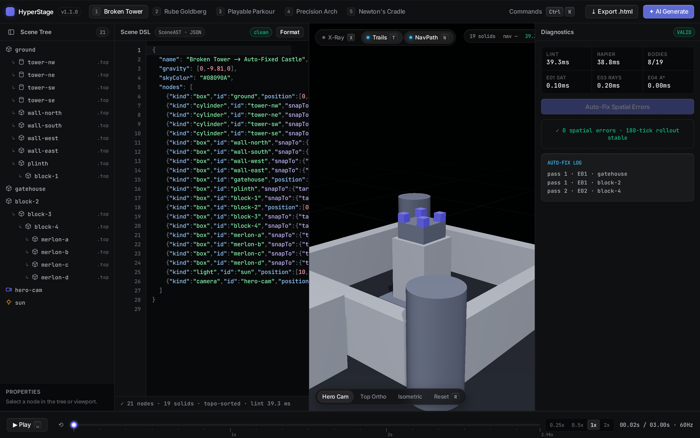
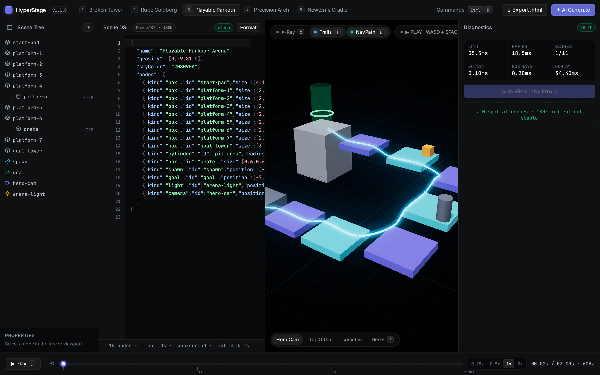

# HyperStage

[](LICENSE)
[](https://github.com/kakarot700/hyperstage/actions/workflows/ci.yml)
[](https://modelcontextprotocol.io)
[](https://rapier.rs)

A deterministic 3D scene, physics, and playable-world compiler built for AI coding agents. Agents write a typed SceneAST, HyperStage lints it for real spatial bugs (overlaps, unstable physics, blocked cameras, unreachable goals) and repairs them automatically.





Agents describe worlds as a typed **SceneAST** (JSON or zero-DOM TSX), place objects **relationally** with `snapTo`, and get back a **spatial lint report** from four deterministic passes: interpenetration (E01), a 180-tick Rapier3D stability rollout (E02), camera occlusion (E03), and goal reachability (E04). Every diagnostic carries a suggested fix, and `autoFixScene` repairs E01–E04 in up to five passes.

```
hyperstage/
├── packages/core            SceneAST schema (Zod v4), JSX runtime, Kahn snapTo resolver, 5 presets
├── packages/spatial-linter  E01 SAT · E02 Rapier rollout · E03 5x5 ray occlusion · E04 voxel A* · auto-fixer
├── packages/mcp-server      stdio MCP server (5 tools) + self-contained HTML exporter
├── packages/cli             `hyperstage` CLI: init · lint · sim · export · skills install
├── packages/skills          3 SKILL.md packs for agents
└── apps/studio              Vite + React + three.js obsidian studio
```

## Quick start

Requires Node 22 (≥ 20 works) and pnpm 10 (`corepack enable` picks up the pinned version).

```bash
git clone https://github.com/kakarot700/hyperstage.git && cd hyperstage
pnpm install
pnpm typecheck && pnpm test && pnpm build

# CLI (after build)
node packages/cli/bin/hyperstage.js init castle.scene.json --preset 1
node packages/cli/bin/hyperstage.js lint castle.scene.json          # exit 1: 2x E01 + 1x E02
node packages/cli/bin/hyperstage.js lint castle.scene.json --fix     # repairs in 2 passes, exit 0
node packages/cli/bin/hyperstage.js sim castle.scene.json --ticks 180
node packages/cli/bin/hyperstage.js export castle.scene.json -o castle.html
node packages/cli/bin/hyperstage.js skills install --target .

# Studio
pnpm --filter @hyperstage/studio dev        # http://localhost:5173
pnpm --filter @hyperstage/studio build && pnpm --filter @hyperstage/studio preview   # http://localhost:4173
```

## SceneAST

```ts
type SceneNode =
  | { kind: "box"; id; size: Vec3; position?; rotationDeg?; snapTo?; material?; physics? }
  | { kind: "sphere"; id; radius; ... }
  | { kind: "cylinder"; id; radiusTop; radiusBottom; height; ... }
  | { kind: "ramp"; id; size: [length, thickness, width]; angleDeg; ... }   // slab tilted about Z
  | { kind: "camera"; id; position; target; fov?; isHero? }
  | { kind: "light"; id; position; intensity; color?; castShadow? }
  | { kind: "spawn"; id; position }
  | { kind: "goal"; id; position; radius };
```

`snapTo: { target, face, align?, offset? }` places a node flush against a face of its target (top +Y, bottom −Y, north −Z, south +Z, east +X, west −X) at exactly 0.000 m contact. The resolver topologically sorts anchors with Kahn's algorithm and throws `AnchorCycleError` with the exact path (`A -> B -> A`).

TSX works too (`"jsxImportSource": "@hyperstage/core"`):

```tsx
const scene = compileJsx(
  <scene name="crates">
    <box id="ground" size={[10, 0.5, 10]} position={[0, -0.25, 0]} />
    <box id="crate" size={[1, 1, 1]} snapTo={{ target: "ground", face: "top" }} physics={{ body: "dynamic" }} />
  </scene>,
);
```

## Spatial linter

| Code | Pass (source) | Method | Rule | Auto-fix |
| --- | --- | --- | --- | --- |
| `E01_INTERPENETRATION` | `passOverlap` (`pass-overlap.ts`) | OBB SAT / sphere closest-point | penetration > 2 mm | translate the dynamic/child body along the MTV (keeps `snapTo`, adjusts `offset`) |
| `E02_UNSTABLE_PHYSICS` | `passPhysics` (`pass-physics.ts`) | Rapier3D deterministic, dt 1/60, 180 ticks | y < −15, drift > 0.5 m before a ramp/collision trigger, tilt > 45° without `allowTip` | `snapTo` the nearest surface directly beneath, footprint supported |
| `E03_CAMERA_OCCLUSION` | `passCamera` (`pass-camera.ts`) | 5×5 ray grid vs AABBs | > 40% of rays blocked | elevate the camera until ≤ 40% blocked |
| `E04_UNREACHABLE_GOAL` | `passNavmesh` (`pass-navmesh.ts`) | 0.25 m voxel columns, 1.5 m clearance, A* with 0.5 m steps and 2.0 m gap jumps | no path | move goal to the closest reachable point |

`lintScene` returns `{ valid, elapsedMs, diagnostics, frames (180 FrameSnapshots), navPath, telemetry }`. `elapsedMs` excludes the one-time Rapier WASM init (singleton in `rapier-loader.ts`).

Measured on the 2-CPU build sandbox (Node 22, warm process, median of 20 runs): 7–17 ms per preset including the 180-tick rollout; worst run 33 ms. A cold single CLI invocation (fresh process, JIT not warmed) measures 22–145 ms.

## MCP server

`node packages/mcp-server/bin/hyperstage-mcp.js` (stdio). Tools:

1. `hyperstage_compile_and_lint({ sceneJson })`
2. `hyperstage_inspect_bounds({ sceneJson })`
3. `hyperstage_simulate_physics({ sceneJson, ticks })`
4. `hyperstage_test_playability({ sceneJson })`
5. `hyperstage_export_html({ sceneJson, title? })`

Every result is returned as both `content[0].text` (JSON) and `structuredContent`; domain errors (invalid JSON, schema issues, anchor cycles) come back as `isError: true`. The server never writes to stdout except JSON-RPC frames; logs go to stderr.

Build first (`pnpm build`), then point your agent at the stdio entry point. Replace `/abs/path/hyperstage` with your clone's absolute path.

**Claude Code** — one command:

```bash
claude mcp add hyperstage -- node /abs/path/hyperstage/packages/mcp-server/bin/hyperstage-mcp.js
```

or commit a project-scoped `.mcp.json`:

```json
{
  "mcpServers": {
    "hyperstage": {
      "command": "node",
      "args": ["/abs/path/hyperstage/packages/mcp-server/bin/hyperstage-mcp.js"]
    }
  }
}
```

**OpenHands** — add to `config.toml`:

```toml
[mcp]
stdio_servers = [
  { name = "hyperstage", command = "node", args = ["/abs/path/hyperstage/packages/mcp-server/bin/hyperstage-mcp.js"] }
]
```

**Cursor** — `.cursor/mcp.json` in the project (or `~/.cursor/mcp.json` globally):

```json
{
  "mcpServers": {
    "hyperstage": {
      "command": "node",
      "args": ["/abs/path/hyperstage/packages/mcp-server/bin/hyperstage-mcp.js"]
    }
  }
}
```

## Studio

Full-viewport obsidian IDE (`#08090A`): live Scene DSL editor with error markers, three.js viewport (OrbitControls, PCF shadows, X-Ray collision wireframes, ghost trajectory trails, glowing nav path, WASD + Space walk mode on playable scenes), diagnostics with one-click **Auto-Fix Spatial Errors** (blocks tween into their repaired positions), a 180-frame timeline, `.html` export, and a BYOK Gemini/Mistral generator that runs Generate → Lint → Auto-Repair for up to 3 iterations with the key kept in `localStorage`.

Presets: 1 Broken Tower → Auto-Fixed Castle · 2 Rube Goldberg Marble Cascade · 3 Playable Parkour Arena · 4 Precision Arch Interior · 5 Newton's Cradle & Dominoes.

## Agent skills

`hyperstage skills install` copies the three packs to `.hark/skills/`, `.openhands/skills/`, `.claude/skills/` and `.cursor/rules/*.mdc` (already installed in this repo).

## Verification

```bash
node verification/verify-studio.mjs
```

The script runs its own `vite build` of the studio, serves `vite preview` on port 4173, and drives it with headless Chromium (SwiftShader WebGL) at 1440×900 @2x: Preset 1 before and after **Auto-Fix**, timeline scrub and play, then Preset 3. It writes `verification/preset1-before.png`, `verification/preset1-after.png`, `verification/preset3.png` and `verification/verification-log.txt`, and exits non-zero on any console error, page error or failed assertion.

Full green gate:

```bash
pnpm install && pnpm typecheck && pnpm test && pnpm build && node verification/verify-studio.mjs
```

## License

MIT
