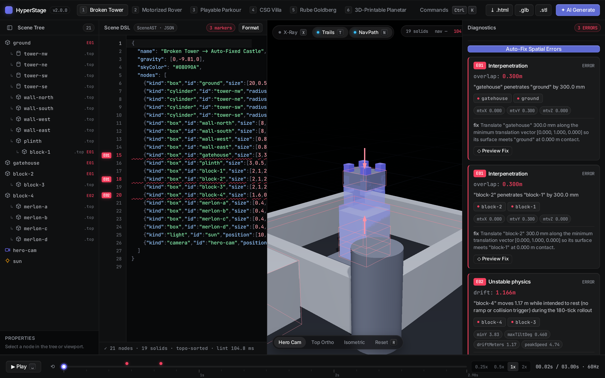
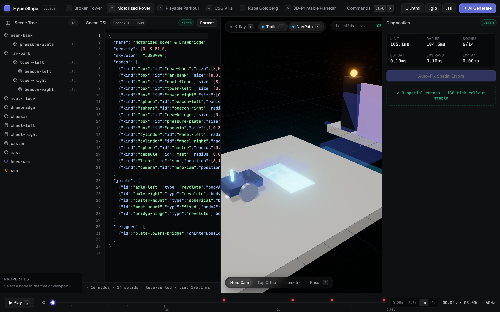
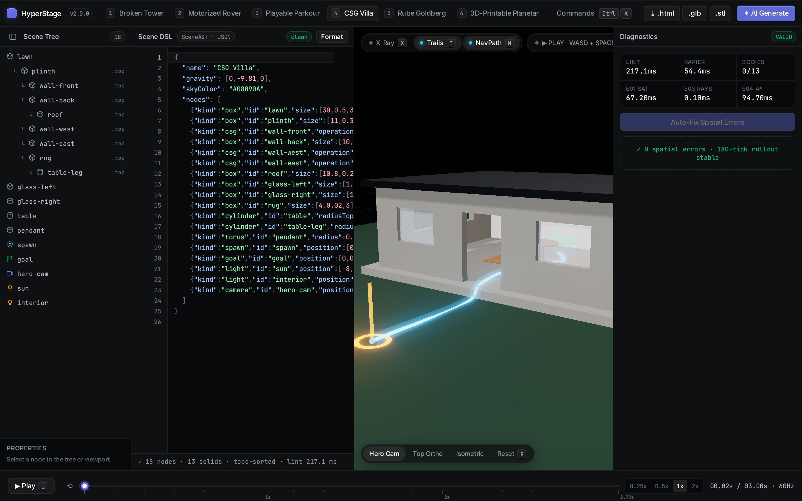
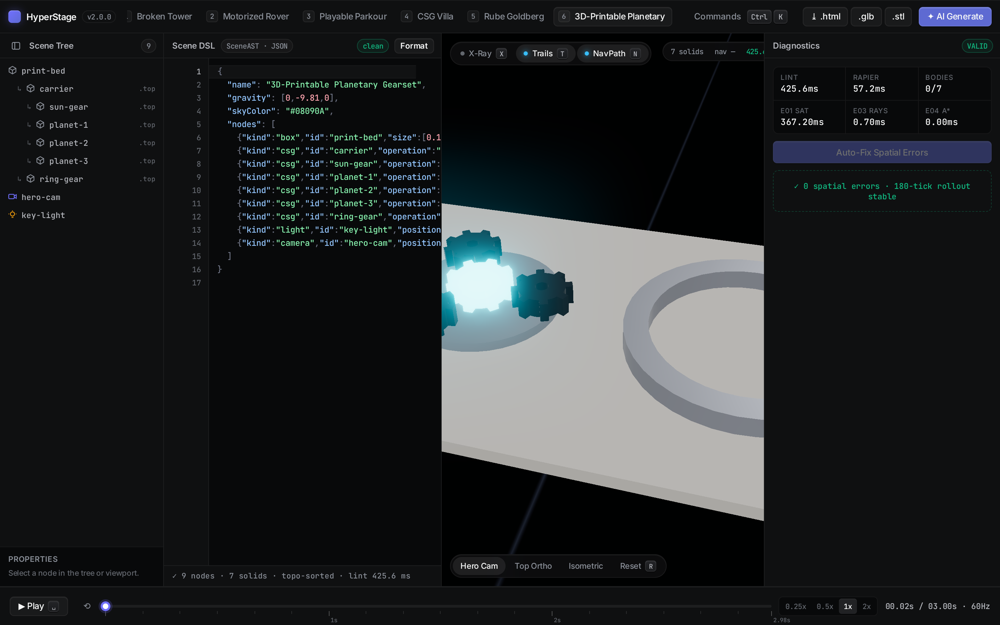
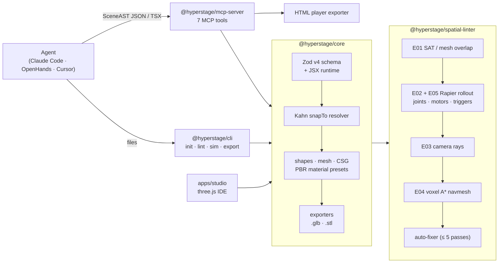

# HyperStage

[](https://github.com/kakarot700/hyperstage/actions/workflows/ci.yml)
[](package.json)
[](LICENSE)
[](https://modelcontextprotocol.io)
[](https://rapier.rs)
[](benchmarks/BENCHMARK.md)

**A deterministic 3D, physics, robotics and CAD compiler built for AI coding agents.**

Agents describe worlds as a typed **SceneAST** (JSON or zero-DOM TSX) and place objects **relationally** with `snapTo` instead of guessing coordinates. HyperStage resolves the anchors, carves CSG solids, simulates joints and motors for 180 ticks in Rapier3D, and returns a **spatial lint report** with a machine-applicable fix for every problem. Clean scenes export to binary glTF (`.glb`), watertight binary STL (`.stl`) for 3D printing, or a standalone playable `.html`.

## Showcase

| | |
| --- | --- |
|  |  |
| **1 · Broken Tower** — 2× E01 interpenetration + 1× E02 unstable block | **→ Auto-Fixed Castle** — repaired in 2 passes, 0 errors |
|  |  |
| **2 · Motorized Rover & Drawbridge** — revolute axles, a pressure-plate trigger lowers the bridge | **3 · Playable Parkour Arena** — voxel A* nav path, WASD + Space |
|  |  |
| **4 · CSG Villa** — doorway and windows carved with `subtract`, walkable | **6 · 3D-Printable Planetary Gearset** — mm-scale CSG, exports a watertight STL |

All screenshots are captured by `node verification/verify-studio.mjs` (headless Chromium, 1440×900 @2x) with zero console or page errors. Preset 5 is a Rube Goldberg Marble Cascade.

## Benchmark

Ten spatial authoring tasks, each written once with absolute coordinates (**baseline**) and once with `snapTo` + `autoFixScene` (**HyperStage**). Full table: [benchmarks/BENCHMARK.md](benchmarks/BENCHMARK.md).

| Metric | Baseline | HyperStage |
| --- | --- | --- |
| Pass rate | 0% | **100%** |
| Median worst-contact error | 75 mm | **0 mm** |
| Median compile (parse + snapTo solve) | n/a | **0.208 ms** (budget < 20 ms) |
| Median full lint (5 passes, 180-tick Rapier rollout) | n/a | 5.33 ms |

The baselines are hand-authored to reproduce mistakes agents commonly make with absolute coordinates (forgotten half-extents, sign errors, misaligned joint anchors, occluded cameras, unreachable goals). They are not measured from a live model. Reproduce with `node benchmarks/run-benchmark.mjs`, which writes `benchmarks/results.json` and `benchmarks/BENCHMARK.md`.

## Quick start

Requires Node 22 (≥ 20 works) and pnpm 10 (`corepack enable` picks up the pinned version).

```bash
git clone https://github.com/kakarot700/hyperstage.git && cd hyperstage
pnpm install
pnpm typecheck && pnpm test && pnpm build

# CLI (after build)
node packages/cli/bin/hyperstage.js init castle.scene.json --preset 1
node packages/cli/bin/hyperstage.js lint castle.scene.json            # exit 1: 2x E01 + 1x E02
node packages/cli/bin/hyperstage.js lint castle.scene.json --fix       # repairs in 2 passes, exit 0
node packages/cli/bin/hyperstage.js sim castle.scene.json --ticks 180
node packages/cli/bin/hyperstage.js export castle.scene.json -o castle.html
node packages/cli/bin/hyperstage.js init gears.scene.json --preset 6
node packages/cli/bin/hyperstage.js export gears.scene.json -o gears.stl   # format inferred, or --format stl
node packages/cli/bin/hyperstage.js export gears.scene.json --format glb -o gears.glb
node packages/cli/bin/hyperstage.js lint rover.scene.tsx --fix         # TSX works; writes rover.scene.fixed.json
node packages/cli/bin/hyperstage.js skills install --target .

# Studio
pnpm --filter @hyperstage/studio dev        # http://localhost:5173
pnpm --filter @hyperstage/studio build && pnpm --filter @hyperstage/studio preview   # http://localhost:4173
```

## Architecture



```
hyperstage/
├── packages/core            SceneAST schema (Zod v4), JSX runtime, snapTo resolver, CSG, materials, .glb/.stl exporters, 6 presets
├── packages/spatial-linter  E01–E05 passes, 180-tick Rapier rollout with joints and triggers, auto-fixer
├── packages/mcp-server      stdio MCP server (7 tools) + standalone HTML player exporter
├── packages/cli             `hyperstage` CLI: init · lint · sim · export · skills install
├── packages/skills          3 SKILL.md packs for agents
├── apps/studio              Vite + React + three.js studio
├── benchmarks/              10-task spatial benchmark
└── verification/            headless Studio verification + screenshots
```

## SceneAST

```ts
type SceneNode =
  | { kind: "box"; id; size: Vec3; position?; rotationDeg?; snapTo?; material?; physics? }
  | { kind: "sphere"; id; radius; ... }
  | { kind: "cylinder"; id; radiusTop; radiusBottom; height; ... }
  | { kind: "ramp"; id; size: [length, thickness, width]; angleDeg; ... }
  | { kind: "capsule"; id; radius; height; ... }                          // v2
  | { kind: "torus"; id; radius; tube; ... }                              // v2
  | { kind: "gltf"; id; url; scale?; fallbackSize: Vec3; ... }            // v2: bounds only, never fetched
  | { kind: "csg"; id; operation: "union" | "subtract" | "intersect"; base: GeometrySpec; tool: GeometrySpec; ... } // v2
  | { kind: "camera"; id; position; target; fov?; isHero? }
  | { kind: "light"; id; position; intensity; color?; castShadow? }
  | { kind: "spawn"; id; position }
  | { kind: "goal"; id; position; radius };

interface SceneAST {
  name; gravity; skyColor; nodes: SceneNode[];
  joints?: JointSpec[];     // v2: fixed | revolute | prismatic | spherical
  triggers?: TriggerSpec[]; // v2: enable_motor | unlock_goal | impulse
}
```

`snapTo: { target, face, align?, offset? }` places a node flush against a face of its target (top +Y, bottom −Y, north −Z, south +Z, east +X, west −X) at exactly 0.000 m contact. The resolver topologically sorts anchors with Kahn's algorithm and throws `AnchorCycleError` with the exact path (`A -> B -> A`).

**Materials** take a preset name (`brushed-metal`, `anodized-dark`, `frosted-glass`, `matte-concrete`, `warm-oak`, `emissive-cyan`, `emissive-amber`, `ceramic-white`) or a custom `{ color, roughness, metalness, opacity, emissive, emissiveIntensity }` object.

**Joints** connect two geometry nodes with body-local anchors `anchorA` / `anchorB`, which must coincide in the rest pose. Revolute and prismatic joints take an `axis` (bodyA frame), limits (`limitsDeg` / `limits`) and an optional motor (`motorVelocity`, `motorMaxForce`). **Triggers** fire once when a dynamic body enters `onEnterNodeId`.

```json
{
  "joints": [
    { "id": "bridge-hinge", "type": "revolute", "bodyA": "far-bank", "bodyB": "drawbridge",
      "anchorA": [0, 0.25, 3], "anchorB": [0, -1.501, 0.1], "axis": [1, 0, 0], "limitsDeg": [0, 90],
      "motorVelocity": 1.6, "motorMaxForce": 400 }
  ],
  "triggers": [
    { "id": "plate-lowers-bridge", "onEnterNodeId": "pressure-plate", "action": "enable_motor", "targetId": "bridge-hinge" }
  ]
}
```

TSX works too (`"jsxImportSource": "@hyperstage/core"`):

```tsx
const scene = compileJsx(
  <scene name="crates">
    <box id="ground" size={[10, 0.5, 10]} position={[0, -0.25, 0]} material="matte-concrete" />
    <box id="crate" size={[1, 1, 1]} snapTo={{ target: "ground", face: "top" }} material="warm-oak" physics={{ body: "dynamic" }} />
  </scene>,
);
```

**Backward compatibility:** every v1.0 SceneAST JSON and TSX scene parses, lints and renders unchanged. The v1 presets remain available via `getPreset` (marble cascade, arch interior, cradle and dominoes).

## Spatial linter

| Code | Pass | Method | Rule | Auto-fix |
| --- | --- | --- | --- | --- |
| `E01_INTERPENETRATION` | `passOverlap` | OBB SAT, then triangle-mesh tests for capsules, tori and CSG | penetration > 2 mm | translate the dynamic/child body along the MTV (keeps `snapTo`) |
| `E02_UNSTABLE_PHYSICS` | `passPhysics` | Rapier3D, dt 1/60, 180 ticks, joints, motors and per-frame triggers | y < −15, drift > 0.5 m, tilt > 45° without `allowTip` (articulated bodies excluded) | `snapTo` the nearest surface beneath |
| `E03_CAMERA_OCCLUSION` | `passCamera` | 5×5 ray grid against meshes | > 40% of rays blocked | elevate the camera |
| `E04_UNREACHABLE_GOAL` | `passNavmesh` | 0.25 m voxels over real CSG openings, 1.5 m clearance, A* with 0.5 m steps and 2.0 m jumps | no path, or goal still locked by a trigger | move the goal to the closest reachable point |
| `E05_BROKEN_JOINT` | `passJoints` | world-space anchor separation, rest pose and rollout | > 0.15 m | `suggestedJointFix` with aligned anchors |

`lintScene` returns `{ valid, elapsedMs, diagnostics, frames (180 FrameSnapshots), navPath, telemetry, notes }`. `elapsedMs` excludes the one-time Rapier WASM init.

## MCP server

`node packages/mcp-server/bin/hyperstage-mcp.js` (stdio, server version 2.0.0). Tools:

1. `hyperstage_compile_and_lint({ sceneJson })`
2. `hyperstage_inspect_bounds({ sceneJson })`
3. `hyperstage_simulate_physics({ sceneJson, ticks })`
4. `hyperstage_test_playability({ sceneJson })`
5. `hyperstage_export_html({ sceneJson, title? })` — interactive player: timeline playback, WASD + Space, camera presets
6. `hyperstage_export_cad({ sceneJson, format: "glb" | "stl" })` — base64 binary glTF 2.0 or watertight binary STL
7. `hyperstage_get_examples({ category?: "game" | "robotics" | "architecture" | "cad" })` — verified, lint-clean starter scenes

Every result comes back as `content[0].text` (JSON) and `structuredContent`; domain errors (invalid JSON, schema issues, anchor cycles) come back as `isError: true`. Only JSON-RPC frames go to stdout; logs go to stderr.

Build first (`pnpm build`), then point your agent at the stdio entry point. Replace `/abs/path/hyperstage` with your clone's absolute path.

**Claude Code**

```bash
claude mcp add hyperstage -- node /abs/path/hyperstage/packages/mcp-server/bin/hyperstage-mcp.js
```

or commit a project-scoped `.mcp.json`:

```json
{
  "mcpServers": {
    "hyperstage": {
      "command": "node",
      "args": ["/abs/path/hyperstage/packages/mcp-server/bin/hyperstage-mcp.js"]
    }
  }
}
```

**OpenHands** — `config.toml`:

```toml
[mcp]
stdio_servers = [
  { name = "hyperstage", command = "node", args = ["/abs/path/hyperstage/packages/mcp-server/bin/hyperstage-mcp.js"] }
]
```

**Cursor** — `.cursor/mcp.json` in the project (or `~/.cursor/mcp.json`):

```json
{
  "mcpServers": {
    "hyperstage": {
      "command": "node",
      "args": ["/abs/path/hyperstage/packages/mcp-server/bin/hyperstage-mcp.js"]
    }
  }
}
```

## Studio

An obsidian IDE (`#08090A`) built on three.js: procedural room-environment lighting, exponential fog, an UnrealBloom → ACES filmic tone-mapping pipeline, PCF shadows and PBR material presets. Around the viewport sit a scene-tree outliner with a properties inspector, a syntax-highlighted Scene DSL editor with per-line error markers, HUD pills (X-Ray, Trails, NavPath, play mode, camera presets), a diagnostics panel with one-click **Auto-Fix Spatial Errors**, a 180-frame physics timeline with collision markers and 0.25×–2× speeds, `.html` / `.glb` / `.stl` export, a command palette (`Ctrl K`) and a BYOK Gemini/Mistral generator that runs Generate → Lint → Auto-Repair (key kept in `localStorage`).

Presets: 1 Broken Tower → Auto-Fixed Castle · 2 Motorized Rover & Drawbridge · 3 Playable Parkour Arena · 4 CSG Villa · 5 Rube Goldberg Marble Cascade · 6 3D-Printable Planetary Gearset.

## Agent skills

`hyperstage skills install` copies three packs (world builder, spatial debug, physics sim) to `.hark/skills/`, `.openhands/skills/`, `.claude/skills/` and `.cursor/rules/*.mdc` (already installed in this repo).

## Verification

```bash
node verification/verify-studio.mjs
```

The script builds the studio, serves `vite preview` on port 4173 and drives it with headless Chromium at 1440×900 @2x: Preset 1 before and after Auto-Fix, timeline scrub and play, presets 2–6 each linting VALID, and `.glb` / `.stl` downloads. It writes the screenshots above plus `verification/verification-log.txt`, and exits non-zero on any console error, page error or failed check.

Full green gate (the same steps CI runs on Node 22):

```bash
pnpm install && pnpm typecheck && pnpm test && pnpm build && node benchmarks/run-benchmark.mjs && node verification/verify-studio.mjs
```

## License

MIT
